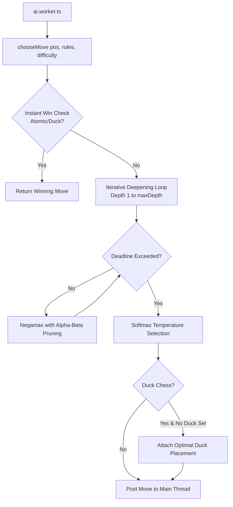

# Chess Sandbox AI Architecture

This document details the search algorithms, evaluation heuristics, difficulty tiers, and concurrency model used by the AI engine in [lib/chess/ai.ts](file:///Users/jhalim/dev/chess-sandbox/chess-lab/lib/chess/ai.ts) and [lib/chess/ai.worker.ts](file:///Users/jhalim/dev/chess-sandbox/chess-lab/lib/chess/ai.worker.ts).

---

## Architectural Principles

1. **Zero External Inference**: The AI runs 100% locally in the user's browser via a dedicated Web Worker. No API keys, cloud LLMs, Stockfish servers, or remote endpoints are used.
2. **Variant Awareness**: Rather than adapting standard chess heuristics, the search and evaluation functions directly understand Duck Chess blocking, Atomic detonations, Crazyhouse pocket reserves, Super Knight movement, King of the Hill center control, and Total Annihilation piece conservation.
3. **Shared Rules Engine**: The AI generates and validates moves solely through [lib/chess/engine.ts](file:///Users/jhalim/dev/chess-sandbox/chess-lab/lib/chess/engine.ts), ensuring zero discrepancies between human and AI legality.

---

## Search Architecture



### 1. Iterative-Deepening Negamax
The AI searches game trees using Negamax with Alpha-Beta pruning:
* Iterative deepening begins at `depth = 1` and increases ply-by-ply up to `maxDepth`.
* When the cooperative time budget expires, the iteration throws a timeout error (`new Error('timeout')`), safely caught by the search harness.
* The search retains the scored move list from the last fully completed iteration, guaranteeing stability and preventing incomplete tree truncation.

### 2. Time Budgets & Difficulty Configurations

| Difficulty | Max Depth | Time Budget | Softmax Temperature | Candidate Score Margin | Style Description |
| --- | :---: | :---: | :---: | :---: | --- |
| **Easy** | 1 ply | 120 ms | 200 | ∞ (All moves) | High variance, exploratory play, forgiving for beginners |
| **Medium** | 3 plies | 500 ms | 40 | 200 cp (2 pawns) | Balanced tactical awareness with natural human variety |
| **Hard** | 5 plies | 1600 ms | 12 | 80 cp (0.8 pawns) | Sharp tactical focus on near-optimal moves |

*Note: Time budgets are checked cooperatively every 16 visited nodes (`(++nodes & 15) === 0`) to maintain zero overhead on inner loops while guaranteeing responsive returns.*

---

## Move Ordering & Pruning

Efficient Alpha-Beta cutoffs depend on testing high-probability moves early. The `priority(p, m)` heuristic sorts candidate moves before expanding subtrees:

1. **Atomic Detonations**: Captures that detonate the enemy king receive top priority (score `100,000`).
2. **King Captures**: Direct king captures in capture variants receive score `100,000`.
3. **MVV-LVA (Most Valuable Victim – Least Valuable Attacker)**:
   * Target piece value is multiplied by 10 and subtracted by attacker value: `targetVal * 10 - fromVal`.
   * Example: Pawn capturing Queen scores higher than Queen capturing Pawn.
4. **Crazyhouse Drops**: Drops receive a base bonus of `40` plus central square proximity bonus: `center * 5`.
5. **Promotions**: Bonus corresponding to the value of the promoted piece.
6. **Iteration Best Move**: The move selected as best in the preceding depth iteration is sorted to the very front of the candidate list for the subsequent depth iteration.

---

## Evaluation Function (`evaluate`)

Position evaluation assigns scores from the perspective of the side whose turn it is (`pos.turn`):

### Base Material Values
* Pawn (`p`): 100 cp
* Knight (`n`): 320 cp (420 cp if `superKnights` is active)
* Bishop (`b`): 335 cp
* Rook (`r`): 500 cp
* Queen (`q`): 900 cp
* King (`k`): 20,000 cp (380 cp in Total Annihilation)

### Positional Adjustments
* **Center Control**: Squares near the four central squares (d4, e4, d5, e5) grant bonuses: `center = 7 - |3.5 - row| - |3.5 - col|`.
* **Pawn Advancement**: Pawns gain points as they push closer to promotion.

### Variant Heuristics
* **Total Annihilation**:
  * Kings are valued at 380 cp (ordinary heavy piece).
  * Every living friendly piece receives an extra **+60 cp survival bounty** to prioritize army preservation over reckless trading.
* **Atomic Chess**:
  * If a simulated board has lost its king, returns `±90,000` immediately.
  * Captures near enemy kings are heavily weighted.
* **Duck Chess**:
  * Evaluates sliding attack rays: if a friendly king is on an open attack line, applies `-8,000 cp`; if the opponent's king is exposed, applies `+8,000 cp`.
* **Crazyhouse**:
  * Pocket reserves are valued at 110% of their base piece value to reward holding tactical drop reserves.
* **King of the Hill**:
  * King receives a high central multiplier (`center * 40`), encouraging active king marches to the hill.
* **Giveaway**:
  * Material values are inverted: possessing fewer pieces yields a higher evaluation.

---

## Softmax Move Selection

Rather than deterministically selecting the single move with the highest score, Chess Sandbox uses a temperature-scaled softmax distribution over candidate moves:

$$\text{Weight}(m_i) = \exp\left(\frac{\text{Score}(m_i) - \text{TopScore}}{T}\right)$$

### Candidate Filtering
Only moves within `margin` centipawns of `TopScore` are eligible for selection:
* `easy`: Considers all legal moves (`margin = ∞`).
* `medium`: Considers moves within 200 cp of the best move.
* `hard`: Considers moves within 80 cp of the best move.

### Decisive Win Bypass
When a forced checkmate or winning move is found (`topScore >= 90000`), the margin drops to **0**:
```typescript
const margin = topScore >= 90000 ? 0 : { easy: Infinity, medium: 200, hard: 80 }[difficulty];
```
This guarantees that whenever the AI discovers a decisive win, it will never play a suboptimal move or delay checkmate due to temperature sampling.

---

## Duck Chess Search Optimization

### The Combinatorial Explosion Challenge
In Duck Chess, a move consists of a piece move followed by placing the neutral Duck on any empty square. On a board with 30 legal piece moves and 50 empty squares, a single turn produces $30 \times 50 = 1,500$ possible transitions. Evaluating all combinations would reduce search depth to 1 ply.

### The Heuristic Solution: `candidateDuckSquares`
Instead of multiplying every piece move by all empty squares, the engine evaluates duck placements using tactical square pruning in [lib/chess/engine.ts](file:///Users/jhalim/dev/chess-sandbox/chess-lab/lib/chess/engine.ts#L368):
1. Squares along sliding piece attack rays targeting the friendly King (defensive blocking).
2. Squares along sliding piece attack rays targeting the enemy King (preventing counter-defense).
3. Squares adjacent to the enemy King (restricting king mobility).
4. Central board squares (d4, e4, d5, e5).

During search:
* Root moves test at most the top 2 candidate duck squares.
* Internal search nodes test only 1 candidate duck square.
* If a move is chosen without an explicit duck placement, the optimal duck square is calculated post-search via `candidateDuckSquares(after, pos.duck)`.

---

## Web Worker Concurrency

The AI is executed inside a dedicated browser Web Worker ([lib/chess/ai.worker.ts](file:///Users/jhalim/dev/chess-sandbox/chess-lab/lib/chess/ai.worker.ts)):

1. **UI Responsiveness**: Heavy search iterations never block React rendering, UI animations, or user interactions.
2. **Artificial Pacing**: A 300 ms UI delay precedes search initiation on the main thread so that human players experience natural turn transitions.
3. **Cancellation Protocol**: Whenever the user clicks **Undo**, starts a **New Game**, switches difficulty, or clicks **Resign**, the main thread invokes `worker.terminate()` immediately, killing obsolete CPU threads.
4. **Message Schema**:
   * Request: `{ position: Position, rules: Rules, difficulty: Difficulty }`
   * Response: `{ move: Move }` or `{ error: string }`
