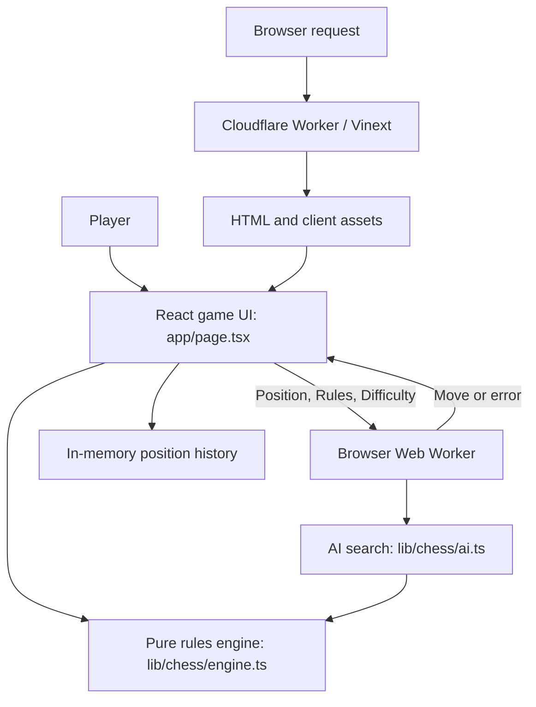

# Chess Sandbox architecture

This document describes the implemented system. Update it in the same commit as changes to module boundaries, game state, rules, AI behavior, dependencies, hosting, or storage. Keep proposed features clearly separate from shipped behavior.

## Product and design constraints

Chess Sandbox is a single-page chess game against a local AI, with customizable rules. Both human move validation and AI search must use the same engine and active rule configuration. Game execution requires no remote inference service, API key, or paid AI calls.

The current product supports local two-player games, but has no online multiplayer service, clocks, board editor, database-backed games, or browser persistence. Reloading starts a fresh game. The main route is `/`.

## System boundaries

The Cloudflare Worker serves the application; it does not play the game. The browser Web Worker is a separate runtime used for CPU-heavy AI search.

## Documentation index

This architecture document serves as the high-level system specification. For specialized deep-dives, see the companion guides:

| Document | Scope |
| --- | --- |
| [VARIANTS.md](file:///Users/jhalim/dev/chess-sandbox/chess-lab/doc/VARIANTS.md) | Detailed specifications of all 8 presets, 13 customizable rule switches, and cross-variant interactions |
| [ENGINE_GUIDE.md](file:///Users/jhalim/dev/chess-sandbox/chess-lab/doc/ENGINE_GUIDE.md) | Pure engine architecture, 64-square coordinate system, move generation pipeline, and adjudication |
| [AI_ARCHITECTURE.md](file:///Users/jhalim/dev/chess-sandbox/chess-lab/doc/AI_ARCHITECTURE.md) | Iterative-deepening Negamax, alpha-beta pruning, evaluation heuristics, softmax move variety, and Web Worker lifecycle |
| [UI_AND_STATE.md](file:///Users/jhalim/dev/chess-sandbox/chess-lab/doc/UI_AND_STATE.md) | React state machine, move lifecycle, CSS animations, color themes, accessibility, and WebMCP |
| [DEVELOPMENT_GUIDE.md](file:///Users/jhalim/dev/chess-sandbox/chess-lab/doc/DEVELOPMENT_GUIDE.md) | Local environment setup, test suite, step-by-step variant creation guide, and verification checklist |

## Module map

| Module | Responsibility |
| --- | --- |
| `app/page.tsx` | Board, setup controls, turn lifecycle, promotion dialogs, history, undo, resignation, move/capture/duck animations, and optional WebMCP state reads |
| `app/layout.tsx` | Document metadata and product icon references |
| `app/globals.css` | Shared theme, board rendering, responsive layout, color-theme palettes, animation keyframes, and branding |
| `app/chatgpt-auth.ts` | Hosting-template scaffolding for ChatGPT user header auth; not used by the chess game |
| `lib/chess/engine.ts` | Types, presets (including detail descriptions), positions, attacks, move generation, move application, outcomes, repetition keys, notation, duck placement helpers |
| `lib/chess/ai.ts` | Evaluation and time-bounded iterative-deepening negamax search with softmax move selection |
| `lib/chess/ai.worker.ts` | Browser worker message adapter for search |
| `components/duck-icon.tsx` | Custom SVG duck icon used on the board, in status banners, and preset selector |
| `components/explosion-icon.tsx` | Custom SVG blast icon used in atomic explosion effects and preset selector |
| `components/ui/` | Vendored accessible UI primitives (Radix/Shadcn), composed by the game screen |
| `tests/engine.test.ts` | Engine correctness checks, special moves, and variant semantics |
| `vite.config.ts` | Vinext, Cloudflare, and retained hosting/preview plugins |
| `build/sites-worker.ts` | Server fetch entry point delegating to Vinext |
| `build/sites-vite-plugin.ts` | Vite plugin for hosting-adapter integration |
| `scripts/run-framework.mjs` | Selects framework execution using the local execution profile |
| `public/chess-sandbox-icon.png` | Canonical product icon, used in the header and document metadata |
| `vendor/` | Vendored Shadcn Tailwind CSS with its license |
| `hooks/use-mobile.ts` | Responsive breakpoint hook |
| `db/` | Drizzle ORM scaffolding; schema is intentionally empty—database is unused |

## Position and rule model

`Position.board` is a 64-element array of pieces or null, indexed from a8 (0) to h1 (63). A piece stores color (`w` or `b`), kind (`p`, `n`, `b`, `r`, `q`, `k`), and an optional `promoted` flag. When `duckChess` is active, `Position.duck` tracks the neutral blocker's square index (`null` before the first placement). When `pieceDrops` is active, `Position.pockets` tracks available reserve pieces for White and Black (`p`, `n`, `b`, `r`, `q`). The position also stores side to move, castling rights, en passant target, halfmove counter, ply count, and an optional `lastExplosion` array of square indexes affected by the most recent atomic detonation.

`Move` contains source and destination indexes (`from: -1` for pocket drops), with optional `duck` square index, `drop` piece kind, promotion kind, en passant victim index, and rook relocation for castling. `applyMove` returns a new position, updating board, duck placement, and pocket reserves. In Duck Chess, notation appends `@<duckSquare>` (e.g., `e4@d5`). When a piece is captured in Crazyhouse, it enters the capturer's pocket in the captured piece's kind, except promoted pieces (`promoted: true`) which return as pawns. Callers must supply a legal move; move application itself is not a validation boundary.

`Rules` contains fourteen options: victory condition, duck chess blocker, piece drops / reserves, atomic explosions, threat / danger warnings, forced captures, castling, en passant, pawn double step, backward pawn captures, super knights, promotion policy, random starting position, and eligible-piece marking. Presets are Classic, Duck Chess, Crazyhouse, Atomic Chess, Total Annihilation, King of the Hill, Giveaway, and Wild Knights. Each preset stores an `id`, `name`, `description`, `icon`, `rules`, and a `details` object containing a `summary` sentence and a `rules` array of bullet-point explanations used in the UI info-box panel.

The engine generates pseudo-legal moves, filters king exposure for royal variants, then enforces mandatory captures. In Duck Chess, royal checks are disabled (`goal: 'capture'`), sliding piece rays and pawn moves cannot pass through or land on the duck (knights jump over it), and the player must move the duck to any other empty square after each piece move. Drops are generated for all empty squares (pawns restricted to ranks 2–7). Drops obey king safety: they can block an existing check, cannot be played elsewhere while leaving the king in check, and cannot expose the king to check. In Atomic Chess (`atomic: true`), any capture triggers an explosion on the target square: the capturing piece, captured piece, and all adjacent non-pawns are removed from the board (pawns survive the blast radius unless directly capturing/captured). Kings cannot capture, touching/connected kings cannot be checked, and moves that blow up own king are illegal while moves that detonate the enemy king award an immediate victory. In Total Annihilation (`goal: 'annihilation'`), the king is non-royal and can be captured at any time without ending the game; check and checkmate are disabled, and a win is awarded only when all enemy pieces (on the board and in pockets) are eliminated, or when the opponent has no legal moves remaining. Giveaway always requires available captures, disables castling, and treats kings as ordinary pieces. Capture-the-king ignores check. Hill wins by reaching d4/e4/d5/e5 with a king or by checkmate. Super knights retain knight jumps and gain adjacent steps; backward pawn captures do not permit backward non-capturing moves.

## State and move lifecycle

1. Setup edits update `draft` rules and `draftHuman`. Active `rules` and `human` remain unchanged until a new game starts. Difficulty changes apply immediately.
2. Selecting a human piece or pocket reserve reveals legal destinations from `legalMoves`. Selecting a pocket piece highlights all legal drop squares on the board. A destination with multiple promotion moves opens a choice dialog.
3. In Duck Chess, selecting a piece move sets `pendingDuckMove` (unless the move captures the king to win immediately), highlighting all legal duck placement squares with pulsating indicators and a banner. Clicking any valid duck square invokes `commitMove` with `{ ...pendingDuckMove, duck }`.
4. `commitMove` triggers a move animation, applies the move, computes notation (e.g. `e4@d5`, `N@e4`, or `Q@g7#`), appends a snapshot, and clears selection.
5. The UI checks terminal engine outcomes, resignation, and threefold repetition (which incorporates pocket reserves, promoted piece marks, and duck placement) across its stored history.
6. On an AI turn, an effect creates a browser worker and sends `{ position, rules, difficulty }`. It returns `{ move }` or `{ error }`.
7. The effect terminates the worker on cleanup. New game, undo, resignation, and difficulty changes cancel obsolete search. Errors show a retry action.

History is the source of truth for the current position. Undo removes the human move and its AI reply, or only the pending human move if the AI has not replied. A new game resets history and selects the board orientation from the chosen human color. Board flipping is presentation-only.

## Move animations and visual effects

Every `commitMove` triggers a coordinated set of CSS-driven animations:

| Effect | Trigger | Implementation |
| --- | --- | --- |
| **Piece glide** | Normal move or castling rook | CSS `piece-glide` keyframe with `--dx`/`--dy` custom properties; 160 ms cubic-bezier ease |
| **Drop entrance** | Pocket piece dropped on the board | `piece-drop-in` scale animation (180 ms) |
| **Capture shatter** | Any captured piece (including en passant) | Four clip-path shards (`shard-tl/tr/bl/br`) fly apart with brightness pulse; 340 ms |
| **Atomic blast** | Capture when `rules.atomic` is active | `blast-expand` on a centered explosion icon plus a glowing ring; 750 ms |
| **Duck glide** | Duck repositioned to a new square | Same `piece-glide` keyframe applied to the SVG duck layer |

Animations are sequenced by an `animSeq` counter ref. Each animation schedules its own cleanup timeout. Starting a new game or undoing clears all pending animations. All motion animations honor `prefers-reduced-motion: reduce`.

## AI behavior and limits

The AI uses iterative-deepening negamax, alpha-beta pruning, capture/promotion move ordering, and variant-aware material/position evaluation. The last completed search iteration supplies the candidate moves when the time budget expires.

Move selection uses softmax-temperature sampling over moves within a score margin of the best:

| Difficulty | Max depth | Budget | Temperature | Margin | Notes |
| --- | --- | --- | --- | --- | --- |
| Easy | 1 ply | 120 ms | 200 | ∞ | Very noisy—nearly uniform random among all moves |
| Medium | 3 plies | 500 ms | 40 | 200 cp | Some randomness within a 2-pawn window |
| Hard | 5 plies | 1600 ms | 12 | 80 cp | Tight focus on the top moves |

When an immediate forced win / checkmate is identified (`topScore >= 90000`), the candidate margin drops to 0, ensuring decisive winning moves bypass temperature sampling and are executed without delay.

Budgets are cooperative checks, not hard real-time guarantees. A 300 ms UI delay precedes search. Strength depends on device speed and variant branching factor; levels are not calibrated Elo ratings. Search has no repetition-history evaluation, transposition table, opening book, or quiescence search.

In Duck Chess, the AI picks duck placement from strategically pruned `candidateDuckSquares`—squares along sliding-piece attack rays toward either king, squares adjacent to the enemy king, and central squares—rather than evaluating every possible duck placement.

Threefold repetition and the 50-move rule are automatically adjudicated. Insufficient-material detection covers a useful subset of classic positions, not every FIDE dead position. Avoid claiming full tournament rules compliance.

## Browser interfaces and accessibility

The board supports click/tap selection, arrow-key focus movement, and Escape to clear selection. Squares expose coordinates and piece names. A prominent banner above the board contains the turn/result heading, human color, move number or terminal reason, and a compact White-versus-Black matchup. White is always on the left and Black on the right, independent of board orientation. Each side shows a Human icon or its AI difficulty icon (smile/easy, bolt/medium, flame/hard), with the side to move outlined. Turn and result changes are announced through an atomic live region. Check, thinking, and finished states have distinct visual treatments; thinking animation respects reduced-motion preferences. Radix/Shadcn supplies dialogs, switches, selectors, and radios.

When supported, the page registers `read_chess_game` through WebMCP. This read-only tool accepts only an empty object and returns the current board, rules, status, and engine-generated legal moves. Unsupported browsers proceed normally. Registration is cleaned up with an abort signal.

## Color themes

The header Color theme selector offers Forest (default), Ocean, Violet, and Amber. The selection sets `data-theme` on the document root. Each theme provides a complete remapping of ~130 CSS custom properties (`--tone-*`), which are referenced by all semantic tokens: board squares, surfaces, accents, text tints, controls, status banners, and portaled dialogs. Error/warning colors and the product icon retain their identity across themes. Theme selection is session-only and does not affect game state or move legality.

## Build and hosting

Use Node.js 22.13+ and the committed npm lockfile. `npm ci` installs the reproducible dependency graph. Keep Wrangler and `@cloudflare/workers-types` peer requirements compatible; change their package declarations and lockfile together.

`npm run build` produces a Cloudflare-compatible server entry in `dist/server/index.js`, generated Wrangler configuration in `dist/server/wrangler.json`, and browser assets in `dist/client`. Direct Cloudflare deployments should use the generated configuration. Do not hand-edit generated output.

The repository retains the original hosting adapter and connector scaffolding (`lib/connector-*.ts`, `build/connector-*`, `app/chatgpt-auth.ts`). The chess route does not invoke external connectors or require D1/R2. `.openai/hosting.json` identifies the original hosting integration; it is not a GitHub repository setting. Local execution profile data under `.sites-runtime/` is ignored, and clean clones default to the portable profile.

## Verification and maintenance

Run `npm run typecheck`, `npm test`, and `npm run build` for changes affecting engine, worker, or application behavior. The engine suite checks opening perft counts 20/400/8902, checkmate, castling restrictions, en passant, promotions, pinned pieces, and custom variants. For dependency changes also verify `npm ci`.

For UI or worker changes, verify a human move plus AI reply, undo, rule activation, and narrow-screen layout in the browser. For rule changes, add a focused position test and verify both human and AI use the rule. For branding changes, check visible header, metadata, icon, package metadata, and README.

Keep this document about the shipped architecture. Update README links and relevant limitations when capabilities change. Do not commit generated build output, TypeScript caches, local credentials, or environment files.

## Randomized starting positions

`initialPosition(rules, random)` accepts the active rules and an injectable random source for reproducible tests. `randomStart` supports three options:

- `off`: Standard initial chess layout and castling rights.
- `except-pawns`: Fisher–Yates shuffles the eight back-rank pieces once and mirrors the order for both colors. Pawns stay on their usual ranks, shielding kings. A classic-order result swaps two pieces so the opening visibly differs.
- `all`: Shuffles all 16 pieces and pawns across each player's home ranks (ranks 1–2 for White, ranks 7–8 for Black), mirrored rank-symmetrically. Redraws if either king would start under check.

With any randomized start active (`except-pawns` or `all`), castling rights are empty throughout the game regardless of the stored castling preference, and the setup UI disables the castling switch.

Randomness runs only when starting a game, never during rendering or AI search. History retains the generated position so undo restores that same opening. Each new game samples a fresh arrangement; repeats are possible. Standard initial positions and preset defaults are unchanged.

## Eligible-piece marking

`Rules.markEligiblePieces` is a visual assistance option: it never changes legal moves or AI evaluation. It defaults to false except for the Giveaway preset. Selecting the Giveaway win condition also enables it; players can turn it off. Like other setup options, edits apply to the next game.

The UI derives eligible source squares directly from the shared engine's `legalMoves` result. On the human turn, and only while the game is ongoing, eligible pieces receive an inset outline, corner marker, and accessible "can move" label. Mandatory capture filtering therefore automatically restricts the markers to legal capturing pieces, including en passant, without separate UI rules. Markers are hidden during AI turns and after a result; destination markers remain separate.

## Threat and danger warnings (beginner assistance)

`Rules.dangerWarnings` is a visual learning assistance option that never changes legal moves or AI evaluation. It defaults to false and can be enabled for any game or custom rule configuration in the rule customizer.

When enabled:
- **Threatened piece detection**: Any friendly piece that can be captured by the opponent on their immediate next move receives a distinct corner warning indicator (`!`) and danger glow on its square (`threatenedPieces`). The calculation accounts for legal pins, royal protections, duck placement, and atomic blast radii.
- **Dangerous destination highlights**: Selecting a piece to move evaluates each destination square with `analyzeMoveDanger`. Destination squares where the moving piece could be captured by the opponent on their next turn are marked with glowing red target indicators (`danger-move-target` or `danger-capture-target`), clearly signaling unsafe squares to learners.
- **Uncovered piece warnings**: If moving a piece vacates a square that leaves a previously covered friendly piece exposed to opponent capture (e.g., discovered attacks or relative pins), the move destination displays an amber warning emblem (`uncover-marker`). Hovering or focusing the destination square highlights the piece that will be left exposed with a pulsed amber-dashed outline and an "Exposed" tag.
- An interactive status banner below the board summarizes current threats and dynamic move safety.

## Random player side

The Play as selector accepts White, Black, or Random. `draftHuman` and `activeSideChoice` retain the selected preference separately from the resolved `human` color. Starting a game samples Random with equal probability for each color, updates the active preference, and orients the board for that color. Black starts trigger the normal AI opening turn. The preference remains Random for subsequent games, and does not incorrectly appear as an unapplied change after resolution. Changing the selector mid-game only stages the next game; flipping and undo do not reroll the side.

## Local opponent and themes

Meet your opponent offers Easy, Medium, Hard, and Human. Human switches the active board into local two-player mode, cancels AI search, and allows the side to move to select pieces. No network session is created. Status names White/Black, eligibility markers follow the active side, promotion uses the moving color, resignation records the resigning color, and undo removes one ply. Board orientation stays fixed until explicitly flipped; Play as is hidden in this mode. Switching back to an AI level resumes AI play using the previously selected human color. Mode changes clear pending selection and promotion without discarding history.

Preset buttons use compact icon/name/description rows with a dedicated info-button (ℹ) that toggles an expandable detail panel showing the preset's summary and bullet-point rules list.
