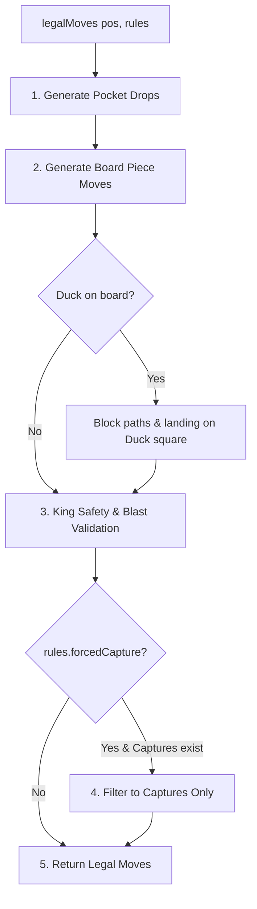

# Chess Sandbox Engine Internals Guide

This guide describes the architecture, data models, move generation algorithms, and adjudication mechanisms in [lib/chess/engine.ts](file:///Users/jhalim/dev/chess-sandbox/chess-lab/lib/chess/engine.ts).

The engine is written in pure TypeScript with zero external dependencies. It is shared identically by the React user interface and the background Web Worker AI search.

---

## Design Principles

1. **Pure Functional State**: Move application does not mutate state. Calling [`applyMove(pos, move, rules)`](file:///Users/jhalim/dev/chess-sandbox/chess-lab/lib/chess/engine.ts#L416) always returns a fresh [`Position`](file:///Users/jhalim/dev/chess-sandbox/chess-lab/lib/chess/engine.ts#L25) object. This enables straightforward undo/redo, deterministic testing, worker message serialization, and clean search trees.
2. **Single Source of Truth**: Human move legality and AI move generation use the exact same function: [`legalMoves(pos, rules)`](file:///Users/jhalim/dev/chess-sandbox/chess-lab/lib/chess/engine.ts#L309). No variant rules are ever implemented exclusively in the UI or in the worker.
3. **No External Libraries**: Standard chess libraries (such as `chess.js`) only support classical FIDE chess and cannot model Duck Chess, Atomic explosions, Crazyhouse pockets, Super Knights, or Total Annihilation.

---

## Coordinate System & Board Representation

The board is represented as a flat 64-element array (`board: (Piece | null)[]`), indexed from top-left (a8 = 0) to bottom-right (h1 = 63):

```text
       Files (col: 0 to 7)
       a   b   c   d   e   f   g   h
    +--------------------------------+
8   |  0   1   2   3   4   5   6   7 |  row 0 (Black back rank)
7   |  8   9  10  11  12  13  14  15 |  row 1 (Black pawns)
6   | 16  17  18  19  20  21  22  23 |  row 2
5   | 24  25  26  27  28  29  30  31 |  row 3
4   | 32  33  34  35  36  37  38  39 |  row 4
3   | 40  41  42  43  44  45  46  47 |  row 5
2   | 48  49  50  51  52  53  54  55 |  row 6 (White pawns)
1   | 56  57  58  59  60  61  62  63 |  row 7 (White back rank)
    +--------------------------------+
```

### Coordinate Conversion Helpers
* `row = Math.floor(sq / 8)` (0 to 7, where 0 is rank 8 and 7 is rank 1)
* `col = sq % 8` (0 to 7, where 0 is file a and 7 is file h)
* [`squareIndex(name: string): number`](file:///Users/jhalim/dev/chess-sandbox/chess-lab/lib/chess/engine.ts#L173): Parses algebraic notation like `'e4'` into square index `36`.
* [`squareName(index: number): string`](file:///Users/jhalim/dev/chess-sandbox/chess-lab/lib/chess/engine.ts#L174): Converts square index `36` into algebraic string `'e4'`.

---

## Core Data Types

### Piece
```typescript
export type Color = 'w' | 'b';
export type Kind = 'p' | 'n' | 'b' | 'r' | 'q' | 'k';
export type Piece = {
  color: Color;
  kind: Kind;
  promoted?: boolean; // Set to true when a pawn promotes (reverts to pawn in Crazyhouse pockets)
};
```

### Position
```typescript
export type Position = {
  board: (Piece | null)[];
  turn: Color;
  rights: string;                    // Castling availability: 'KQkq', 'Kq', '', etc.
  ep: number | null;                  // En passant target square index or null
  halfmove: number;                   // 50-move clock counter
  ply: number;                        // Total half-moves played in the game
  pockets?: Pockets;                  // Available reserve pieces for White and Black
  duck?: number | null;               // Square index of the Duck blocker or null
  lastExplosion?: number[] | null;    // Square indexes affected by the most recent atomic blast
};
```

### Move
```typescript
export type Move = {
  from: number;                       // 0..63 for on-board moves, -1 for pocket drops
  to: number;                         // Destination square index 0..63
  drop?: PocketKind;                  // 'p' | 'n' | 'b' | 'r' | 'q' if dropped from pocket
  duck?: number;                      // Square index where the Duck is placed (Duck Chess)
  promotion?: Kind;                   // Promoted piece kind ('q', 'r', 'b', 'n')
  ep?: number;                        // Square index of the captured pawn in an en passant move
  rook?: [number, number];            // [from, to] square indexes for rook relocation during castling
};
```

---

## Move Generation Pipeline

The [`legalMoves(pos, rules)`](file:///Users/jhalim/dev/chess-sandbox/chess-lab/lib/chess/engine.ts#L309) function executes a structured 5-stage generation pipeline:



### Stage 1: Pocket Drops (`rules.pieceDrops`)
When reserve pieces exist in `pos.pockets[pos.turn]`:
* Empty board squares are scanned.
* Pawns are restricted to rows 1–6 (ranks 2–7).
* Non-pawns can be dropped on any empty square (ranks 1–8).
* Each drop creates `{ from: -1, to: sq, drop: kind }`.

### Stage 2: Board Piece Traversal
* **Pawns**: Single-square advances, two-square initial steps (if `rules.doubleStep`), diagonal captures, en passant captures (if `rules.enPassant`), backward diagonal captures (if `rules.backwardCapture`), and promotions (rank 8 for White, rank 1 for Black).
* **Knights**: Standard 8 L-jumps `[[-2,-1], [-2,1], [-1,-2], [-1,2], [1,-2], [1,2], [2,-1], [2,1]]`. If `rules.superKnights` is active, also generates the 8 adjacent 1-square steps.
* **Sliders (Bishops, Rooks, Queens)**: Ray-casting along diagonal or orthogonal directions until hitting the board edge, another piece, or the Duck.
* **Kings**: 1-square steps in all directions. Castling moves are generated if rights exist, path is clear of pieces and Duck, and king does not pass through or land on attacked squares.

### Stage 3: King Safety & Explosion Filtering
* In **Total Annihilation** (`goal: 'annihilation'`) and **Giveaway** (`goal: 'giveaway'`), king safety is completely bypassed. Kings may move into attacks.
* In **Duck Chess** (`goal: 'capture'`), check does not exist; moves cannot be disqualified for exposing the king to check.
* In **Atomic Chess** (`rules.atomic`):
  * Moves where the king detonates itself are illegal.
  * Moves where the opponent's king detonates are unconditionally legal and deliver instant victory.
  * When kings are touching (adjacent), neither king is in check.
* In all royal variants (Classic, Crazyhouse, Hill):
  * The simulated resulting position is checked via [`inCheck(nextPos, pos.turn, rules)`](file:///Users/jhalim/dev/chess-sandbox/chess-lab/lib/chess/engine.ts#L295). Moves that leave the king under attack are pruned.

### Stage 4: Mandatory Capture Enforcement (`rules.forcedCapture`)
If `rules.forcedCapture` is enabled and at least one capturing move was generated:
* Non-capturing moves are pruned.
* Only capturing moves (including en passant and atomic captures) are returned.

---

## State Transition: `applyMove`

[`applyMove(pos, move, rules)`](file:///Users/jhalim/dev/chess-sandbox/chess-lab/lib/chess/engine.ts#L416) creates a new position:

1. **Board Copy**: Clones the 64-element board.
2. **Pocket Updates**:
   * If a drop occurred (`move.drop`), decrements the pocket count.
   * If a normal capture occurred under Crazyhouse, increments the capturer's pocket. Promoted pieces (`promoted: true`) convert to pawns in the pocket.
3. **Move Execution**:
   * Drops place the new piece on `move.to`.
   * Board moves copy piece from `move.from` to `move.to`, marking `promoted: true` if a promotion occurred.
   * Castling moves relocate the associated rook (`move.rook`).
   * En passant moves clear the captured pawn from `move.ep`.
4. **Atomic Blast Execution**:
   * If `rules.atomic` and a capture occurred, removes the capturing piece, the captured piece, and all adjacent non-pawns. Records square indexes in `lastExplosion`.
5. **Duck Update**:
   * Sets `duck` square index to `move.duck` if provided, otherwise preserves existing duck.
6. **Counters & Turn**:
   * Resets `halfmove` on pawn moves or captures; increments otherwise.
   * Increments `ply` by 1 and alternates `turn` (`w` <-> `b`).
   * Updates castling rights and en passant target square.

---

## Adjudication & Game Outcomes

[`outcome(pos, rules, moves)`](file:///Users/jhalim/dev/chess-sandbox/chess-lab/lib/chess/engine.ts#L457) evaluates terminal states:

```typescript
export type Outcome = {
  winner: Color | null; // 'w' | 'b' | null (null indicates draw)
  reason: string;        // 'Checkmate', 'Stalemate', 'King captured', etc.
};
```

1. **King Capture**: In `goal: 'capture'`, if the turn side's king is missing, the opponent wins (`'King captured'`).
2. **King of the Hill**: In `goal: 'hill'`, if a king occupies squares 27, 28, 35, or 36, that king's owner wins immediately (`'King reached the hill'`).
3. **Atomic Blast**: In `rules.atomic`, if a king was destroyed in an explosion, the surviving side wins (`'King exploded'`).
4. **Total Annihilation**: In `goal: 'annihilation'`:
   * If all White pieces (board + pockets) are gone, Black wins (`'All pieces eliminated'`).
   * If all Black pieces are gone, White wins.
   * If a player has pieces remaining but `moves.length === 0`, they lose (`'No legal moves'`).
5. **Giveaway**: In `goal: 'giveaway'`:
   * If a player has no pieces remaining, they win (`'All pieces lost'`).
   * If a player has pieces but `moves.length === 0`, they win (`'No legal moves'`).
6. **Classic Checkmate & Stalemate**:
   * If `moves.length === 0`:
     * If `inCheck`: Loss by `'Checkmate'`.
     * If not `inCheck`: Draw by `'Stalemate'`.
7. **Draw by 50-Move Rule**:
   * If `halfmove >= 100` and `!rules.pieceDrops`: Draw by `'50-move rule'`.
8. **Draw by Insufficient Material**:
   * Evaluated via [`insufficientMaterial(pos, rules)`](file:///Users/jhalim/dev/chess-sandbox/chess-lab/lib/chess/engine.ts#L442). Detects bare kings, single bishop/knight, and same-color bishops when piece drops are off.

---

## Algebraic Notation

The [`notation(pos, move, rules, moves)`](file:///Users/jhalim/dev/chess-sandbox/chess-lab/lib/chess/engine.ts#L478) function formats legal moves into standard or variant-extended SAN:

* **Drops**: Piece letter + `@` + destination (e.g., `N@e4`, `Q@g7`).
* **Castling**: `O-O` (kingside) or `O-O-O` (queenside).
* **Piece Moves**: Piece letter + disambiguation (if another identical piece can reach the square) + `x` (if capture) + target square.
* **Duck Placement**: Suffix `@<square>` (e.g., `e4@d5`, `Nf3@e5`).
* **Check / Checkmate Suffixes**: Evaluates resulting position to append `+` (check) or `#` (checkmate).
